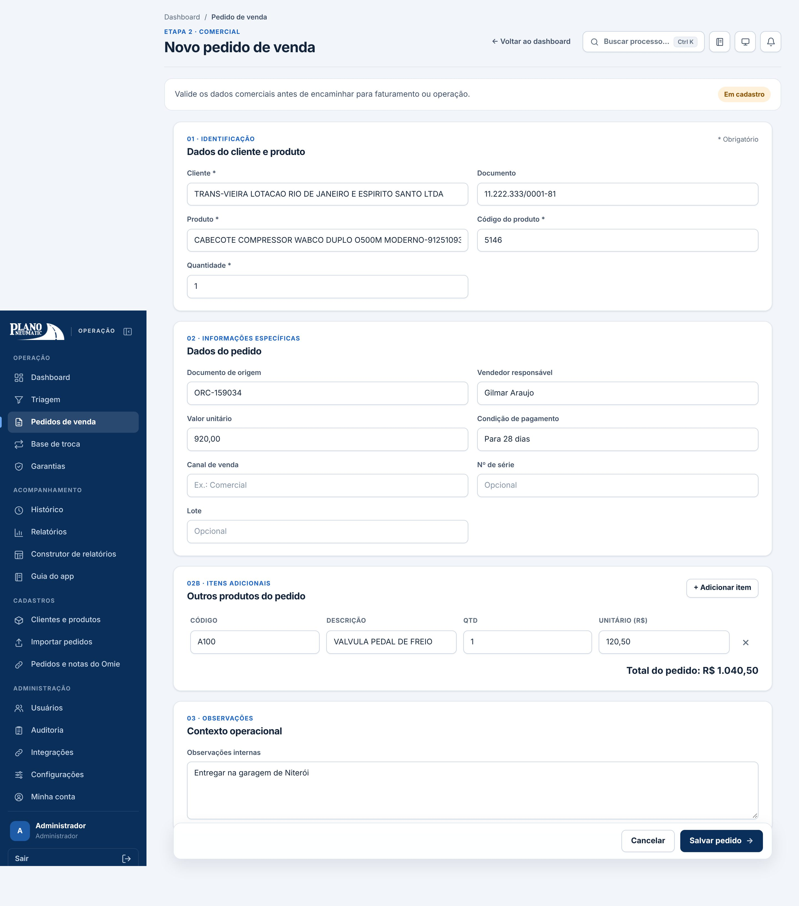
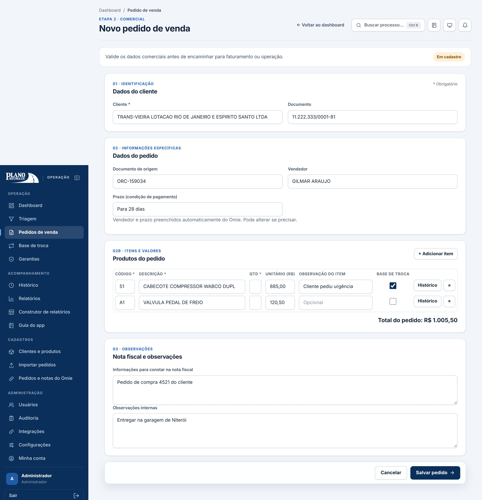
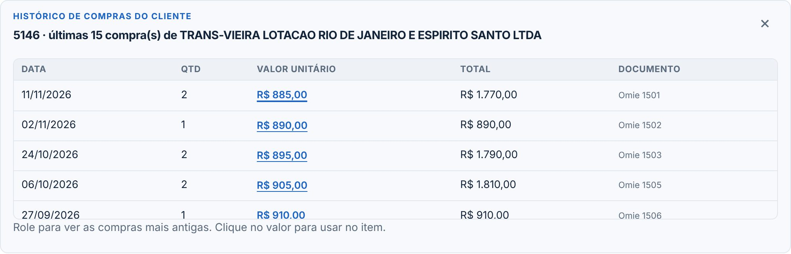
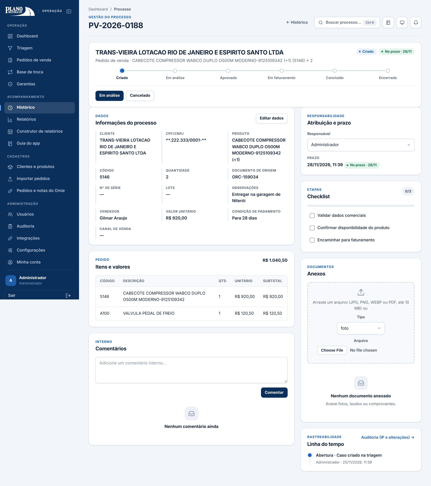
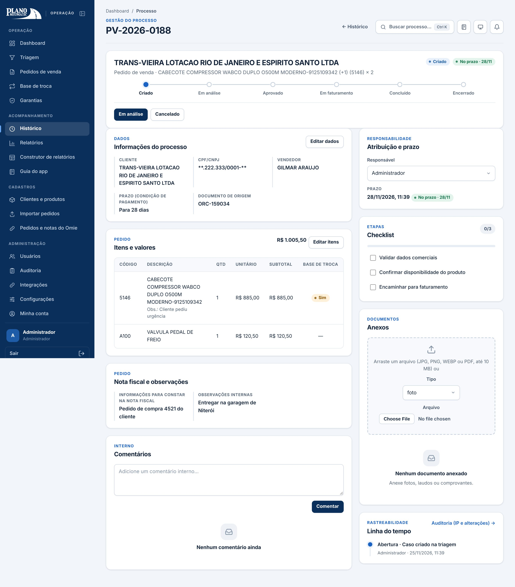
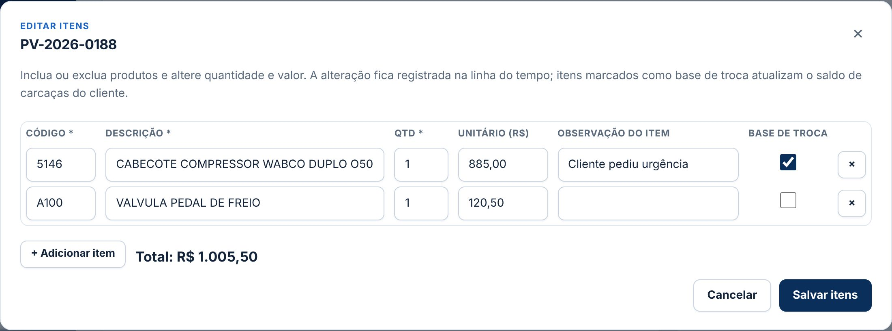
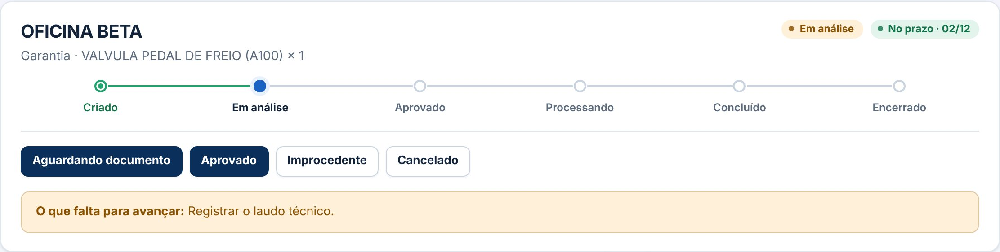
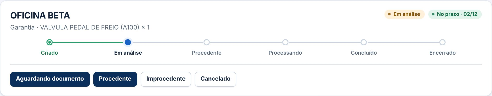
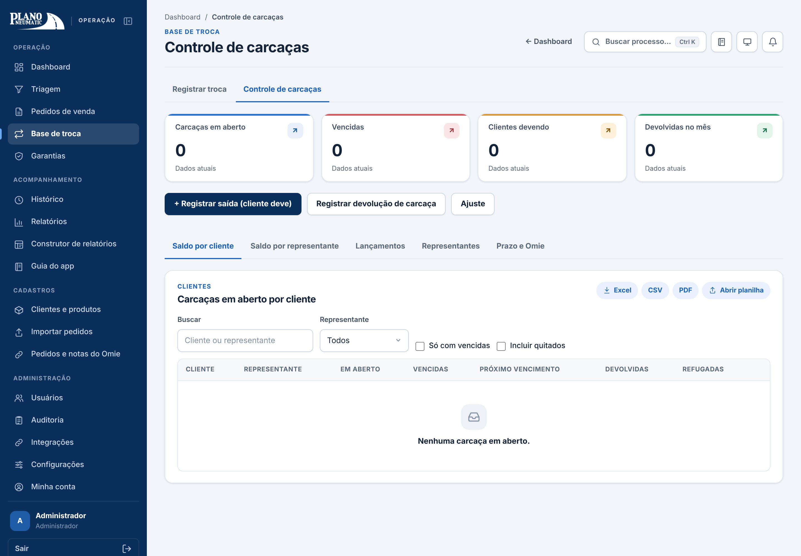
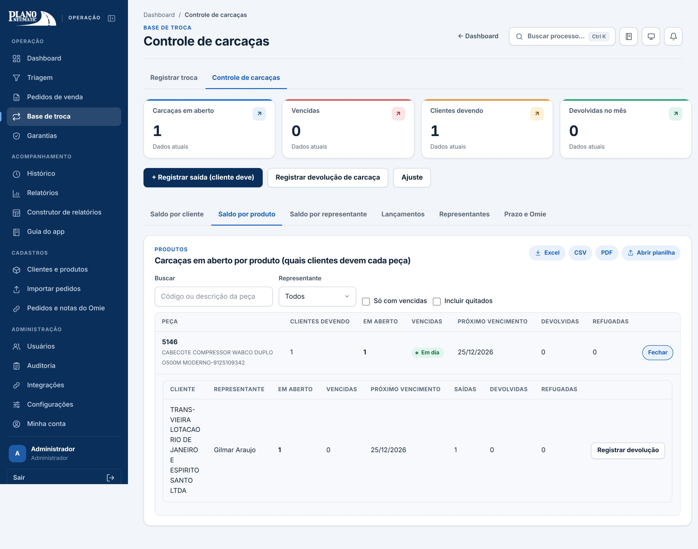

# Alterações pedidas pela Plano (novembro/2026)

Origem: documento "ALTERAÇÕES APP PLANO". Código no pull request #20 (branch `alteracoes-app-plano`).
As imagens estão em `antes/` (sistema antes da mudança) e `depois/`.

## Decisões combinadas com o Leandro

- "Aprovado" vira **"Procedente"** só na **Garantia** e na **Troca**. O Pedido de venda continua "Aprovado".
- Histórico de venda no pedido: **só as compras deste cliente**, as **últimas 15**, numa caixa pequena com rolagem.
- "Campo 03 - constar para nota fiscal": campo de texto **"Informações para constar na nota fiscal"** na seção 03 do pedido.

## O que foi feito (item a item do documento)

| # | Pedido da Plano | Como ficou |
|---|---|---|
| 1 | Ao jogar o código, puxar o produto (ou vice-versa) | Na tabela de itens, digitar o código completa a descrição, e digitar a descrição completa o código. |
| 2 | Puxar vendedor e prazo do Omie | Ao escolher o cliente, vendedor e prazo são preenchidos com o cadastro do cliente no Omie (aba Recomendações). Se faltar, vêm do último pedido do cliente no Omie, do último pedido no app ou do representante. |
| 3 | Últimos 10 ou 15 valores de venda | Caixa "Histórico de compras do cliente" com as últimas 15 compras da peça por este cliente (data, quantidade, valor, total e documento), com rolagem. Clicar no valor aplica no item. |
| 4 | Observação no produto | Cada item tem o campo "Observação do item". |
| 5 | Campo 03 - constar para nota fiscal | Campo "Informações para constar na nota fiscal", separado das observações internas. |
| 6 | Itens adicionais: histórico, código/produto e observação | Todos os itens ficam numa tabela só, com as mesmas funções (histórico, código ↔ descrição e observação). |
| 7 | Pedido lançado: Inf. processo só com cliente, prazo, vendedor e doc. origem | "Informações do processo" mostra só cliente, CPF/CNPJ, vendedor, prazo e documento de origem. A NF e as observações ficam num quadro próprio. |
| 8 | Produtos só em Itens e valores; editar depois de lançado | Os produtos aparecem só em "Itens e valores". O botão "Editar itens" inclui e exclui produtos e muda quantidade e valor, e tudo fica registrado na linha do tempo. |
| 9 | Sinalizar base de troca ao incluir o item; aparece na aba Base de troca | O item tem a marcação "Base de troca", que já vem marcada para peça remanufaturada. Ao salvar, a dívida da carcaça entra sozinha no Controle de carcaças. Editar o pedido corrige a dívida e cancelar estorna. |
| 10 | Na Base de troca, marcar devolvido com nº do documento | A devolução pede o "Nº do documento da devolução" (NF de entrada, romaneio). |
| 11 | Relatório por cliente e por produto | Já existia o "Saldo por cliente". Foi criado o **"Saldo por produto"**, que mostra quais clientes devem cada peça. Os dois exportam para Excel, CSV e PDF. |
| 12 | Garantia: não exigir laudo para finalizar | O laudo técnico ficou opcional para procedente e improcedente. |
| 13 | Trocar "Aprovado" por "Procedente" | Feito na Garantia e na Troca. |

## Antes e depois

### Novo pedido de venda
| Antes | Depois |
|---|---|
|  |  |

### Histórico de compras do cliente (novo)

### Pedido lançado
| Antes | Depois |
|---|---|
|  |  |

### Editar itens depois de lançado (novo)

### Garantia em análise
| Antes | Depois |
|---|---|
|  |  |

### Controle de carcaças
| Antes | Depois |
|---|---|
|  |  |

## Parte técnica (para o Herick)

- Migration `017_order_items_and_sales_defaults.sql`, que só acrescenta: `case_items.notes` e `case_items.carcass`, `cases.invoice_notes`, `omie_sellers`, `omie_payment_terms`, e `customers.omie_seller_code` e `omie_payment_code`.
- Novas rotas:
  - `PUT /api/cases/:id/items`
  - `GET /api/customers/:id/sales-defaults`
  - `GET /api/products/sales-history?code=&customerId=`
  - `GET /api/carcass/summary?groupBy=product`
- Omie: sincronização de `ListarVendedores` e `ListarParcelas`; o cliente guarda `recomendacoes.codigo_vendedor` e `numero_parcelas`. Os nomes dos campos foram testados com respostas simuladas. **Conferir na primeira sincronização real** (Integrações → Sincronizar agora).
- Débito de carcaça vindo do pedido usa `source = 'case'`. A NF do Omie ligada ao mesmo pedido não gera o débito em dobro.
- Testes: `orders.test.js` e `sales-data.test.js` novos. Suíte com 108 testes, e2e com 11, lint e formatação, tudo ok.
